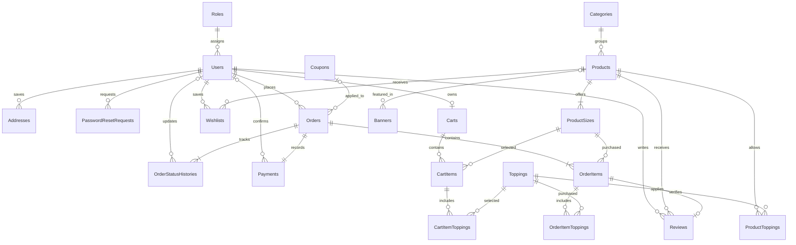

# Bước 2 — ERD và cấu trúc solution Tiệm Chè

Thiết kế này dùng cho ứng dụng WPF .NET 8 và API .NET 10. API thực thi nghiệp vụ và truy cập SQLite qua EF Core 10 Code First với `Microsoft.EntityFrameworkCore.Sqlite` và `UseSqlite`. Ứng dụng WPF gọi API qua HTTPS.

Một phiên bản API dùng tệp `tiemche.db` trong thư mục dữ liệu trên máy chạy API. Máy đó cần quyền ghi vào thư mục. Khi chạy thử, WPF và API có thể chạy trên cùng một máy. Khi dùng nhiều máy WPF, các máy kết nối cùng địa chỉ API. Migration sẽ tạo cơ sở dữ liệu mới và được áp dụng một lần trước khi chạy API.

## ERD

| Ký hiệu | Ý nghĩa |
|---|---|
| `\|\|` | Một bản ghi bắt buộc |
| `o\|` | Không hoặc một bản ghi |
| `o{` | Không hoặc nhiều bản ghi |
| `\|{` | Một hoặc nhiều bản ghi |



### Dữ liệu chính và khóa

Mỗi bảng dùng khóa chính `Id`, trừ các bảng ghi rõ khóa ghép. Các cột kết thúc bằng `Id` trong bảng dưới đây là khóa ngoại, ngoại trừ khóa chính `Id`.

| Bảng | Cột nghiệp vụ chính và ràng buộc |
|---|---|
| `Roles` | `Id`, `Name` duy nhất. Seed ba vai trò Customer, Staff và Admin. |
| `Users` | `RoleId`, `Email`, `NormalizedEmail` duy nhất, `PasswordHash`, `FullName`, `Phone`, `IsActive`. |
| `Addresses` | `UserId`, người nhận, số điện thoại, địa chỉ, `IsDefault`. Mỗi khách có tối đa một địa chỉ mặc định. |
| `PasswordResetRequests` | `UserId`, `CodeHash`, `ExpiresAtUtc`, `UsedAtUtc`, số lần thử. |
| `Categories` | Tên, thứ tự hiển thị, trạng thái hoạt động. |
| `Products` | `CategoryId`, tên, mô tả, đường dẫn ảnh, trạng thái bán, ngày tạo. |
| `ProductSizes` | `ProductId`, tên size, giá bán, trạng thái bán. Tên size duy nhất trong từng món. Món không có lựa chọn size hiển thị dùng một size mặc định. |
| `Toppings` | Tên, giá, đường dẫn ảnh, trạng thái bán. |
| `ProductToppings` | Khóa ghép `(ProductId, ToppingId)`. Giới hạn topping có thể chọn theo món. |
| `Carts` | `UserId` duy nhất và `Version` kiểu `Guid` để phát hiện thay đổi đồng thời. |
| `CartItems` | `CartId`, `ProductSizeId`, số lượng. Hai dòng cùng size có thể khác bộ topping. |
| `CartItemToppings` | Khóa ghép `(CartItemId, ToppingId)`. Một topping được chọn tối đa một lần trên mỗi phần. |
| `Wishlists` | Khóa ghép `(UserId, ProductId)`, ngày thêm. |
| `Coupons` | Mã chuẩn hóa duy nhất, loại giảm theo phần trăm hoặc số tiền, giá trị, mức giảm tối đa nếu có, giá trị đơn tối thiểu, thời hạn, số lượt đã dùng, giới hạn lượt dùng, trạng thái hoạt động. |
| `Orders` | `UserId`, `CouponId` tùy chọn, mã đơn duy nhất, mã yêu cầu đặt đơn, mã coupon đã áp dụng, thông tin giao hàng đã chốt, tiền món, tiền giảm, phí giao, tổng thanh toán, trạng thái, ngày đặt, `Version` kiểu `Guid`. Mã yêu cầu đặt đơn duy nhất theo khách để xử lý gửi lại. |
| `OrderItems` | `OrderId`, `ProductSizeId`, tên món và tên size đã chốt, đơn giá size, số lượng và thành tiền gồm topping. |
| `OrderItemToppings` | Khóa ghép `(OrderItemId, ToppingId)`, tên và đơn giá topping đã chốt. |
| `Payments` | `OrderId` duy nhất, phương thức, trạng thái, số tiền phải thu, thời điểm ghi nhận và `ConfirmedByUserId` nếu có. |
| `OrderStatusHistories` | `OrderId`, trạng thái trước và sau, thời điểm, ghi chú và `ChangedByUserId` nếu có. Khi tạo đơn, trạng thái trước để trống. |
| `Reviews` | `UserId`, `ProductId`, `OrderItemId` duy nhất, điểm 1–5, nội dung, trạng thái hiển thị, ngày tạo. Cặp `(UserId, ProductId)` duy nhất. |
| `Banners` | Tiêu đề, đường dẫn ảnh, `ProductId` tùy chọn, thứ tự, thời gian hiển thị, trạng thái hoạt động. |

### Quy tắc nghiệp vụ và toàn vẹn

- Một tài khoản có đúng một vai trò. API kiểm tra quyền theo vai trò và quyền sở hữu tài nguyên cho từng thao tác. Ví dụ, mã đơn không cấp quyền xem đơn cho khách khác.
- Khoảng giá trong danh sách sản phẩm dùng giá thấp nhất của các size đang bán. API kiểm tra lại giá, trạng thái size, topping được phép chọn và điều kiện coupon khi đặt đơn.
- Tạo đơn, ghi nhận lượt dùng coupon, tạo bản ghi thanh toán, thêm lịch sử trạng thái ban đầu và xóa các dòng đã mua khỏi giỏ trong cùng một giao dịch ngắn. Cập nhật bộ đếm coupon có điều kiện ngay trong SQL để giữ giới hạn lượt dùng khi nhiều khách đặt cùng lúc. Khi đơn hợp lệ được hủy, lượt dùng coupon được trả lại trong giao dịch hủy.
- EF Core cấu hình `Version` làm concurrency token. API đổi token khi sửa giỏ, kể cả sửa dòng hàng hoặc topping, và khi đổi trạng thái đơn hay thanh toán. API bật kiểm tra khóa ngoại trong kết nối SQLite. [Xử lý cập nhật đồng thời trong EF Core](https://learn.microsoft.com/en-us/ef/core/saving/concurrency#application-managed-concurrency-tokens)
- Bản ghi thanh toán tách khỏi trạng thái giao hàng. Đơn chuyển khoản cần được xác nhận thanh toán trước khi giao. Với đơn tiền mặt, thao tác hoàn thành của nhân viên ghi nhận đã thu tiền. Khách được hủy đơn chờ xác nhận nếu chưa thanh toán.
- Giá và địa chỉ trên hóa đơn đọc từ dữ liệu đã chốt trên đơn. Danh mục, món, size hoặc topping đã xuất hiện trong lịch sử được ngừng sử dụng bằng cờ trạng thái để giữ liên kết. Mua lại dùng danh mục và giá hiện tại, đồng thời báo các lựa chọn đã ngừng bán.
- API kiểm tra đánh giá thuộc đúng khách, đúng món và có dòng hàng trong đơn hoàn thành. Dashboard ghi nhận doanh thu từ đơn hoàn thành đã thanh toán, theo ngày hoàn thành tại múi giờ Việt Nam. Lưu thời điểm dưới dạng `DateTime` UTC.
- Lưu tiền theo đơn vị đồng bằng `long` trong C# và `INTEGER` trong SQLite để lọc giá và cộng doanh thu trong truy vấn. Với coupon phần trăm, lưu tỷ lệ theo đơn vị 0,01 điểm phần trăm và làm tròn số tiền giảm đến đồng khi tính. [Giới hạn kiểu dữ liệu của SQLite trong EF Core](https://learn.microsoft.com/en-us/ef/core/providers/sqlite/limitations#query-limitations)

## Cấu trúc solution

```text
TiemChe.sln
src/
  TiemChe.Domain/
    Models/                       Thực thể nghiệp vụ
    Enums/                        Vai trò, trạng thái đơn, thanh toán, loại giảm
  TiemChe.Application/
    Interfaces/                   Hợp đồng dịch vụ và truy cập dữ liệu
    Services/                     Tài khoản, danh mục, giỏ, checkout, đơn, báo cáo
    Validation/                   Quy tắc nghiệp vụ dùng ở máy chủ
  TiemChe.Infrastructure/
    Data/
      TiemCheDbContext.cs
      Configurations/             Ánh xạ EF Core, khóa, chỉ mục, ràng buộc
      Migrations/                 Migration SQLite
      Seed/                       Vai trò, danh mục, món, size và topping mẫu
    Services/                     BCrypt, SMTP, lưu ảnh, tạo file Excel
  TiemChe.Contracts/
    Auth/                         DTO tài khoản và xác thực
    Catalog/                      DTO thực đơn, size, topping, đánh giá và banner
    Shopping/                     DTO giỏ, yêu thích, checkout, đơn và địa chỉ
    Management/                   DTO quản trị và báo cáo
  TiemChe.Api/
    Controllers/                  Điểm cuối HTTP cho khách và quản trị
    Authorization/                Chính sách vai trò và quyền sở hữu
    Program.cs                    Đăng ký DI, xác thực, cấu hình SQLite
  TiemChe.Wpf/
    Services/                     API client, phiên đăng nhập, điều hướng, in hóa đơn
    ViewModels/                   Trạng thái màn hình và lệnh MVVM
      Auth/
      Customer/
      Staff/
      Admin/
    Views/                        XAML, nhóm theo vai trò như ViewModels
    Resources/                    Theme Material Design, màu xanh lá và kem
    App.xaml                      Tài nguyên và mẫu ánh xạ ViewModel sang View
    App.xaml.cs                   Khởi động và đăng ký DI
docs/
  02-thiet-ke.md
```

Luồng xử lý chính đi từ View WPF qua ViewModel, API client, API, Application Service, rồi đến EF Core và SQLite. ViewModel dùng CommunityToolkit.Mvvm. Màn hình in hóa đơn dùng dịch vụ in WPF. Dashboard dùng LiveCharts2. Ảnh do API lưu trong thư mục dữ liệu cấu hình trên máy chủ và trả đường dẫn để WPF tải.

Các phụ thuộc chính là `Contracts → Domain` để dùng chung enum, `Application → Contracts`, `Infrastructure → Application`, `Api → Infrastructure` và `Wpf → Contracts`. WPF và API dùng DTO chung để giữ hợp đồng HTTP đồng bộ. `TiemCheDbContext` triển khai hợp đồng `ITiemCheData` cho truy vấn và giao dịch của các dịch vụ nghiệp vụ.
