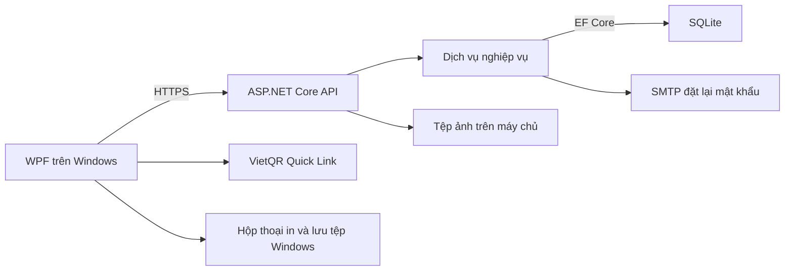

# Mô tả hệ thống Tiệm Chè

Tài liệu mô tả chức năng của nhánh `wpf-nhanvien`. Đối tượng sử dụng gồm khách ghé thăm, khách hàng, nhân viên và quản trị viên. [Hướng dẫn clone, cài đặt và chạy](../README.md).

## Mục lục

- [Kiến trúc và phạm vi sử dụng](#1-kiến-trúc-và-phạm-vi-sử-dụng)
- [Vai trò và quyền truy cập](#2-vai-trò-và-quyền-truy-cập)
- [Tài khoản và phiên đăng nhập](#3-tài-khoản-và-phiên-đăng-nhập)
- [Luồng khách hàng](#4-luồng-khách-hàng)
- [Luồng nhân viên](#5-luồng-nhân-viên)
- [Trạng thái đơn và thanh toán](#6-trạng-thái-đơn-và-thanh-toán)
- [Luồng quản trị viên](#7-luồng-quản-trị-viên)
- [Dữ liệu và các quy tắc chung](#8-dữ-liệu-và-các-quy-tắc-chung)
- [Bản đồ API](#9-bản-đồ-api)
- [Kịch bản kiểm tra và phạm vi hiện tại](#10-kịch-bản-kiểm-tra-và-phạm-vi-hiện-tại)

## 1. Kiến trúc và phạm vi sử dụng

- **WPF (.NET 8)** hiển thị giao diện, điều hướng theo vai trò, gửi yêu cầu HTTPS và trình bày kết quả. Hộp thoại in và lưu tệp chạy trên máy người dùng.
- **API (.NET 10)** xác thực tài khoản, kiểm tra quyền, tính tiền, quản lý giao dịch và trả dữ liệu cho WPF. Mặc định WPF gọi `https://localhost:7048/`. Biến `TIEMCHE_API_URL` chọn một địa chỉ HTTPS khác.
- **SQLite** lưu dữ liệu tập trung theo từng API. Khi nhiều máy WPF kết nối cùng một API, các máy dùng chung thực đơn và dữ liệu cửa hàng, còn quyền truy cập phụ thuộc tài khoản đăng nhập. Khi chạy cùng máy, mở API trước rồi mở WPF.
- **Hạ tầng** gồm EF Core để truy cập dữ liệu, BCrypt để băm mật khẩu, SMTP để gửi mã đặt lại, lưu ảnh trên máy chạy API và tạo báo cáo Excel. WPF tải ảnh VietQR từ địa chỉ API trả về.

## 2. Vai trò và quyền truy cập

| Đối tượng | Vào hệ thống bằng cách nào | Công việc chính |
| --- | --- | --- |
| Khách ghé thăm | Mở WPF | Xem trang chủ, thực đơn, chi tiết món và đánh giá công khai. Có thể đăng ký hoặc đăng nhập. |
| Khách hàng (`Customer`) | Tự đăng ký rồi đăng nhập | Lưu món yêu thích và địa chỉ, quản lý giỏ, đặt đơn online, xem đơn của mình, hủy đơn hợp lệ, mua lại và đánh giá. |
| Nhân viên (`Staff`) | Admin cấp tài khoản | Theo dõi đơn, bán tại quầy, xác nhận thanh toán, xử lý hủy và ghi nhận hoàn tiền, quản lý ca tiền mặt, tra cứu khách, đổi tình trạng món và kiểm duyệt hiển thị đánh giá. |
| Quản trị viên (`Admin`) | Khởi tạo Admin đầu tiên bằng lệnh `--bootstrap-admin` | Có quyền vận hành của nhân viên và thêm quyền cấu hình thực đơn, khuyến mãi, banner, tài khoản, kiểm duyệt đánh giá, báo cáo và xem lịch sử ca toàn cửa hàng. |

WPF chọn menu theo vai trò. API kiểm tra quyền độc lập và kiểm tra quyền sở hữu đối với địa chỉ, giỏ, món yêu thích và đơn của khách. Các tài khoản đã đăng nhập đều có mục **Hồ sơ của tôi** và thao tác đăng xuất.

## 3. Tài khoản và phiên đăng nhập

### Đăng ký, cấp tài khoản và đăng nhập

1. Khách nhập họ tên, email, mật khẩu và số điện thoại nếu có tại tab **Đăng ký**. API chuẩn hóa email để kiểm tra trùng và tạo tài khoản với vai trò `Customer`.
2. Admin đầu tiên được tạo sau khi áp dụng migration. Lệnh bootstrap đọc cấu hình `Seed__AdminEmail`, `Seed__AdminPassword` và `Seed__AdminName` nếu có. API từ chối bootstrap khi cơ sở dữ liệu đã có Admin.
3. Admin mở **Nhân viên**, nhập họ tên, email, mật khẩu và số điện thoại tùy chọn để cấp tài khoản `Staff`. Email dùng chung quy tắc duy nhất với các vai trò khác.
4. Cả ba vai trò dùng màn hình **Đăng nhập** chung. API kiểm tra email, mật khẩu BCrypt và trạng thái hoạt động. WPF lấy hồ sơ sau khi nhận token rồi đưa khách về luồng mua sắm, nhân viên vào **Tổng quan ca** và Admin vào **Tổng quan**.

### Hồ sơ, đổi mật khẩu và quên mật khẩu

- Hồ sơ cho phép cập nhật họ tên và điện thoại. Email và vai trò được dùng để nhận diện tài khoản. Mật khẩu có tối thiểu 10 ký tự và tối đa 72 byte UTF-8.
- Đổi mật khẩu yêu cầu mật khẩu hiện tại. Đặt lại mật khẩu yêu cầu email, mã nhận qua SMTP và mật khẩu mới. API lưu mã dưới dạng băm, cho dùng một lần, hiệu lực 15 phút và tối đa 5 lần thử.
- Khi SMTP đã cấu hình, yêu cầu gửi mã dùng phản hồi chung cho email có hoặc không có tài khoản hoạt động. Nếu thiếu SMTP, API báo chức năng gửi email chưa được cấu hình.
- Token đăng nhập có hiệu lực 2 giờ. Đổi mật khẩu, đặt lại mật khẩu hoặc đổi trạng thái tài khoản cập nhật dấu phiên để thu hồi token cũ. Khi token mất hiệu lực, WPF chuyển về màn hình đăng nhập. Đăng xuất xóa phiên trong WPF.

## 4. Luồng khách hàng

### 4.1. Trang chủ, thực đơn và chi tiết món

| Màn hình | Thao tác và dữ liệu |
| --- | --- |
| **Trang chủ** | Xem banner đang trong thời gian hiển thị, danh mục hoạt động, tối đa 6 món bán chạy và 6 món mới. Banner có thể dẫn đến món đang bán. |
| **Thực đơn** | Tìm theo tên hoặc mô tả bằng tiếng Việt có dấu hoặc không dấu. Lọc danh mục, giá tối thiểu và tối đa. Sắp xếp theo món mới, bán chạy, tên hoặc giá tăng/giảm và chuyển trang. |
| **Chi tiết món** | Xem ảnh, mô tả, danh mục, các size đang bán, topping cho phép, điểm và nhận xét công khai. Chọn size, topping và số lượng để xem giá tạm tính. |
| **Món yêu thích** | Lưu hoặc bỏ lưu món cho tài khoản hiện tại, mở lại chi tiết từ danh sách. Khi khách ghé thăm chọn lưu hoặc thêm giỏ, WPF đưa họ đến màn hình đăng nhập. |

Giá hiển thị trong danh sách là giá của size đang bán rẻ nhất. Món cần có danh mục hoạt động và ít nhất một size đang bán để xuất hiện trong thực đơn công khai.

### 4.2. Sổ địa chỉ và giỏ hàng

1. Mở **Sổ địa chỉ** để thêm, sửa hoặc xóa địa chỉ. Một địa chỉ gồm người nhận, điện thoại và địa chỉ giao. Mỗi khách có thể đặt tối đa một địa chỉ mặc định. Địa chỉ mặc định được ưu tiên khi chọn giao hàng.
2. Tại chi tiết món, chọn size, topping và số lượng rồi thêm vào giỏ. Giỏ gộp các dòng có cùng size và cùng bộ topping. Hai phần cùng size nhưng khác topping được lưu thành hai dòng.
3. Mở **Giỏ hàng** để xem đơn giá, topping, số lượng, thành tiền, chỉnh số lượng hoặc bỏ dòng. Giới hạn là 100 dòng, mỗi dòng từ 1 đến 99 phần và mỗi cấu hình tối đa 30 topping.
4. API kiểm tra tình trạng món, danh mục, size và topping khi sửa giỏ và khi đặt đơn. Nếu món đã ngừng bán hoặc giỏ đã đổi trên máy khác, khách cần tải lại và điều chỉnh giỏ trước khi tiếp tục.

### 4.3. Đặt hàng online

1. Từ giỏ hàng, mở **Thanh toán**, chọn địa chỉ thuộc tài khoản và chọn phương thức. **Tiền mặt khi nhận** có sẵn. **Chuyển khoản** hiện khi API đã nhận đủ thông tin tài khoản thụ hưởng.
2. Nhập mã giảm giá nếu có rồi yêu cầu tính tổng. API đọc giá hiện tại, kiểm tra điều kiện mã và tính tiền món, giảm giá, phí giao và tổng phải trả. Phí giao mặc định là 15.000 ₫.
3. Xem tổng tiền và xác nhận đặt đơn. API tính lại trước khi lưu. Nếu giá, giỏ hoặc điều kiện khuyến mãi đã đổi, WPF hiển thị thông báo để khách kiểm tra và xác nhận lại.
4. Khi thành công, đơn có kênh `Online`, trạng thái **Chờ xác nhận**, thanh toán **Chưa thanh toán**. API lưu địa chỉ, tên món, size, topping và giá đã chốt trên đơn, ghi lịch sử và xóa các dòng đã mua khỏi giỏ.
5. WPF mở chi tiết đơn. Nếu chọn chuyển khoản, màn hình hiển thị thông tin người nhận và mã VietQR khi cấu hình có mã ngân hàng hợp lệ. Mã gắn với số tiền và mã đơn đã tạo.

### 4.4. Sau khi đặt đơn

- **Đơn của tôi** hiển thị đơn thuộc tài khoản hiện tại. Khách có thể tìm theo mã đơn, người nhận hoặc điện thoại, lọc theo trạng thái và chuyển trang. Chi tiết có mã đơn, người nhận, món, các khoản tiền, trạng thái đơn và thanh toán, lịch sử công khai và nút **In hóa đơn**.
- **Hủy đơn** dành cho khách khi đơn còn **Chờ xác nhận** và **Chưa thanh toán**. Hệ thống đổi trạng thái đơn và thanh toán sang đã hủy, đồng thời trả lại lượt dùng coupon nếu có.
- **Mua lại** đưa các lựa chọn còn bán vào giỏ theo giá hiện tại. Hệ thống báo các dòng bị bỏ qua do món, size hoặc topping không còn khả dụng hoặc giỏ đã đạt giới hạn.
- **Đánh giá** cho phép chọn món từ đơn hoàn thành, chấm 1–5 sao và nhập nhận xét tối đa 2.000 ký tự. API kiểm tra đơn thuộc tài khoản và dòng hàng khớp với món. Mỗi khách chỉ đánh giá một lần cho mỗi món. Đánh giá được hiển thị công khai khi còn ở trạng thái hiển thị.

## 5. Luồng nhân viên

Các thao tác trong mục này dùng quyền vận hành của `Staff` và `Admin`.

### 5.1. Tổng quan ca và đối soát tiền mặt

1. **Tổng quan ca** hiển thị số đơn trong ngày theo trạng thái, số đơn chờ xác nhận và chưa thanh toán, tổng tiền mặt, tổng chuyển khoản đã xác nhận và số đơn người đang đăng nhập đã xử lý. Mốc ngày tính theo giờ Việt Nam. Chọn một trạng thái để mở danh sách đơn tương ứng.
2. Nhập tiền mặt đầu ca rồi bấm **Mở ca**. Mỗi người chỉ có một ca đang mở. WPF cảnh báo nếu chưa mở ca khi bán tại quầy.
3. Trong ca, số tiền mặt dự kiến bằng **tiền đầu ca + tiền mặt đã ghi nhận bởi người mở ca trong khoảng thời gian ca**. Tiền chuyển khoản hiển thị riêng và số đơn được tính theo các thanh toán đã xác nhận.
4. Khi đóng ca, nhập tiền mặt kiểm đếm. **Chênh lệch = tiền kiểm đếm − tiền dự kiến**. Nếu khác 0, phải nhập ghi chú. API lưu thời điểm đóng, các số tiền và ghi chú. WPF có thao tác in biên bản ca.
5. **Lịch sử ca** có API phân trang theo ca của nhân viên hiện tại. Admin có API xem toàn bộ ca và lọc theo nhân viên. Tình trạng màn hình WPF hiện tại được ghi ở mục 10.

### 5.2. Bán hàng tại quầy

1. Mở **Đặt món tại quầy**, lọc danh mục hoặc tìm món, chọn size, topping và số lượng. Thêm, tăng, giảm hoặc xóa dòng. Giới hạn là 100 dòng và 99 phần mỗi dòng.
2. Có thể tìm khách hoạt động theo họ tên, email hoặc điện thoại và liên kết đơn với tài khoản đã chọn. Với khách vãng lai, để trống lựa chọn khách. API dùng một tài khoản nội bộ không đăng nhập, còn tên và điện thoại trên đơn lấy từ thông tin nhập hoặc giá trị mặc định. API lưu riêng người tạo đơn.
3. Nhập ghi chú cho bếp hoặc mã giảm giá nếu cần. Hệ thống tính lại tổng từ giá đang bán, kiểm tra coupon và áp dụng phí giao bằng 0. Nhân viên xác nhận tổng trước khi gửi yêu cầu tạo đơn.
4. Chọn phương thức và cách xử lý. Với **tiền mặt + hoàn thành ngay**, API tạo đơn `InStore` đã hoàn thành và đã thu tiền. Với **tiền mặt + gửi bếp**, đơn ở **Đang chuẩn bị** và **Chưa thanh toán** đến khi được hoàn thành.
5. Với **chuyển khoản**, WPF tạo đơn `InStore` đang chuẩn bị và chờ thanh toán để có mã đơn trước. Màn hình kết quả hiện thông tin thụ hưởng, số tiền, nội dung và mã VietQR nếu khả dụng.
6. Sau khi đối chiếu tiền vào tài khoản, bấm **Xác nhận đã nhận chuyển khoản**. Nếu đã chọn hoàn thành ngay, API ghi thanh toán và hoàn thành trong cùng giao dịch. Nếu đã chọn gửi bếp, đơn tiếp tục ở trạng thái **Đang chuẩn bị** cho đến khi nhân viên hoàn thành.
7. Từ kết quả tạo đơn, nhân viên có thể in hóa đơn, in phiếu bếp, in tem cốc, mở chi tiết hoặc bắt đầu đơn mới. WPF mở hộp thoại in của Windows để chọn máy in.

### 5.3. Quản lý và xử lý đơn

- **Quản lý đơn** hỗ trợ tìm theo mã đơn, tên người nhận hoặc điện thoại, lọc kênh online/tại quầy, trạng thái đơn, phương thức và trạng thái thanh toán. Có bộ lọc ngày nhanh **Hôm nay**, **Hôm qua**, **7 ngày**, **Tất cả**, hoặc chọn khoảng ngày. Danh sách có phân trang và tùy chọn xem đơn cũ nhất trước.
- Bộ theo dõi vận hành lấy số đơn chờ định kỳ khoảng 20 giây để cập nhật huy hiệu trên menu. Màn hình quản lý đơn có làm mới định kỳ và tùy chọn âm báo khi số đơn chờ tăng.
- **Chi tiết đơn** hiển thị món, giá đã chốt, lịch sử, người tạo đơn tại quầy, thông tin thanh toán và các thao tác hợp lệ theo trạng thái. Nhân viên có thể xác nhận chuyển khoản, cập nhật trạng thái, hủy và ghi nhận hoàn tiền, hoặc in chứng từ phù hợp.
- **Ghi chú nội bộ** lưu nội dung, tác giả và thời gian. API chỉ trả ghi chú nội bộ cho nhân viên và Admin. Khách chỉ thấy phần lịch sử được công khai.

### 5.4. Tra cứu khách, tình trạng món và đánh giá

| Chức năng | Nghiệp vụ |
| --- | --- |
| **Tra cứu khách** | API tìm tối đa 10 tài khoản khách đang hoạt động theo tên, email hoặc điện thoại, bỏ qua tài khoản nội bộ của khách vãng lai. Khi chọn khách, ViewModel có thể tải lịch sử đơn phân trang và mở chi tiết đơn. Tình trạng màn hình WPF được ghi ở mục 10. |
| **Tình trạng món** | Xem và đổi trạng thái bán của món, từng size hoặc topping. Khi trạng thái thực sự thay đổi, API lưu nhật ký với tên đối tượng, giá trị cũ/mới, người thao tác và thời gian trong cùng giao dịch. |
| **Đánh giá** | Xem danh sách đánh giá và lọc theo trạng thái hiển thị. Nhân viên có thể ẩn hoặc hiện đánh giá. Quyền xóa thuộc Admin. |

## 6. Trạng thái đơn và thanh toán

### 6.1. Chuyển trạng thái đơn

| Kênh | Từ trạng thái | Đến trạng thái | Điều kiện |
| --- | --- | --- | --- |
| Online | Chờ xác nhận (`Pending`) | Đang chuẩn bị (`Preparing`) | Nhân viên hoặc Admin tiếp nhận. |
| Online | Đang chuẩn bị | Đang giao (`Delivering`) | Đơn tiền mặt hoặc đơn chuyển khoản đã xác nhận thanh toán. |
| Online | Đang giao | Hoàn thành (`Completed`) | Nhân viên hoặc Admin hoàn thành. API ghi đã thu tiền với phương thức tiền mặt. |
| Tại quầy | Tạo mới | Đang chuẩn bị | Gửi bếp hoặc chờ chuyển khoản. |
| Tại quầy | Tạo mới | Hoàn thành | Luồng WPF thu tiền mặt và hoàn thành ngay. |
| Tại quầy | Đang chuẩn bị | Hoàn thành | Có thể ghi nhận thu tiền mặt khi hoàn thành. Với chuyển khoản, thanh toán phải được xác nhận trước hoặc trong cùng thao tác xác nhận và hoàn thành tại quầy. |
| Cả hai | Chờ xác nhận hoặc Đang chuẩn bị | Đã hủy (`Cancelled`) | Nhân viên hoặc Admin nhập lý do ít nhất 5 ký tự. Nếu đã thu tiền, hệ thống ghi nhận hoàn tiền. Khách chỉ hủy được đơn của mình khi còn chờ xác nhận và chưa thanh toán. |

### 6.2. Thanh toán và VietQR

| Trạng thái | Ý nghĩa |
| --- | --- |
| `Unpaid` | Đơn đã được lưu và khoản tiền đang chờ ghi nhận. |
| `Paid` | Hệ thống đã ghi nhận thu tiền mặt hoặc nhân viên đã xác nhận chuyển khoản, kèm người xác nhận và thời điểm. |
| `Cancelled` | Đơn bị hủy khi khoản tiền chưa được ghi nhận. |
| `Refunded` | Nhân viên hủy đơn đã thu tiền và ghi nhận hoàn tiền. API lưu người thực hiện và thời điểm. |

- Chuyển khoản cần tên ngân hàng, số tài khoản và tên chủ tài khoản. Để tạo QR, hệ thống cần mã BIN suy ra từ tên ngân hàng đã hỗ trợ hoặc từ trường `BankBin`. Một đơn có tổng tiền dương mới tạo URL QR.
- Mã VietQR dùng mã ngân hàng, số tài khoản, số tiền và mã đơn. WPF đọc ảnh SVG của VietQR trên màn hình tại quầy và chi tiết đơn đang chờ thanh toán. Nếu chưa xác định được BIN, phần thông tin tài khoản vẫn có thể dùng để chuyển khoản thủ công.
- Sau khi khách chuyển khoản, nhân viên đối chiếu tiền nhận thực tế rồi xác nhận trong WPF. API dùng phiên bản đơn để phát hiện người khác vừa cập nhật. Ghi nhận hoàn tiền trong WPF là thao tác nghiệp vụ, tiền được hoàn cho khách qua quy trình thực tế của cửa hàng.
- Thông tin tài khoản hiển thị được lấy từ cấu hình API hiện tại. Mã đơn và số tiền lấy từ đơn đã lưu. Tệp cấu hình cục bộ, điều kiện hiện nút chuyển khoản và lệnh khởi động lại API được mô tả trong [README](../README.md#4-khởi-động-api).

## 7. Luồng quản trị viên

### 7.1. Quản lý dữ liệu cửa hàng

| Màn hình | Thao tác | Quy tắc |
| --- | --- | --- |
| **Danh mục** | Thêm, sửa tên, thứ tự hiển thị, bật hoặc ngừng hoạt động. | Ngừng danh mục làm các món thuộc danh mục đó rời thực đơn công khai. |
| **Món và size** | Tìm món, thêm/sửa tên, mô tả, ảnh, danh mục, trạng thái, size, giá và danh sách topping được phép. | Mỗi món có từ 1 đến 20 size, tên size không trùng trong món, món đang bán cần ít nhất một size đang bật. Một món có tối đa 30 topping. Các dòng đã xuất hiện trong đơn giữ dữ liệu đã chốt. |
| **Topping** | Thêm/sửa tên, giá, ảnh và trạng thái. | Topping cần được liên kết với món và còn hoạt động mới xuất hiện cho khách chọn. |
| **Mã giảm giá** | Tạo, sửa và ngừng mã giảm theo số tiền cố định hoặc tỷ lệ. Có thể nhập mức giảm tối đa, tiền món tối thiểu, thời gian và giới hạn lượt dùng. | Mã được chuẩn hóa thành chữ hoa, chỉ nhận chữ không dấu, số, gạch nối và gạch dưới. Giới hạn lượt mới phải từ số lượt đã dùng trở lên. |
| **Banner** | Tạo, sửa, xóa banner, tải ảnh, đặt thứ tự và khoảng hiển thị, tùy chọn liên kết món. | Banner cần ảnh và khoảng thời gian hợp lệ. Banner gắn món chỉ xuất hiện công khai khi món đủ điều kiện bán. |
| **Đánh giá** | Xem, lọc, ẩn/hiện hoặc xóa đánh giá. | Đánh giá bị ẩn được giữ để có thể hiện lại. Lệnh xóa của Admin xóa bản ghi. |
| **Khách hàng** | Tìm, xem, khóa hoặc mở khóa tài khoản khách. | Khi đổi trạng thái tài khoản, phiên cũ mất hiệu lực. |
| **Nhân viên** | Tìm, xem, cấp tài khoản, khóa hoặc mở khóa nhân viên. | Form cấp nhân viên tạo vai trò `Staff`. API từ chối khóa tài khoản Admin qua chức năng này. |

Ảnh món, topping và banner được tải qua API. API nhận PNG hoặc JPEG tối đa 5 MB và trả đường dẫn ảnh để ghi cùng dữ liệu tương ứng.

### 7.2. Tổng quan, doanh thu và Excel

1. Mở **Tổng quan**, chọn khoảng ngày và nhóm theo ngày hoặc theo tháng. Khi không truyền khoảng ngày, API mặc định 30 ngày đến ngày hiện tại theo giờ Việt Nam.
2. **Tổng đơn** đếm theo ngày đặt. **Số đơn hoàn thành** và **doanh thu** lấy các đơn đã hoàn thành và đã thanh toán theo ngày hoàn thành. Vì dùng mốc thời gian khác nhau, hai chỉ số có thể thay đổi độc lập trong cùng kỳ.
3. Xem biểu đồ doanh thu và danh sách tối đa 10 món bán chạy theo số lượng trong các đơn đủ điều kiện của kỳ. Danh sách món có tổng tiền dòng hàng. Doanh thu toàn kỳ dùng tổng tiền đã chốt của đơn.
4. Bấm **Xuất Excel** để tải báo cáo cho kỳ đã chọn, rồi chọn vị trí lưu trên máy. Admin cũng có quyền truy vấn lịch sử ca của toàn cửa hàng và lọc theo nhân viên.

## 8. Dữ liệu và các quy tắc chung

| Nhóm dữ liệu | Bảng và quan hệ chính |
| --- | --- |
| Danh tính | `Roles` gán vai trò cho `Users`. `Addresses` và `PasswordResetRequests` thuộc người dùng. Email chuẩn hóa là duy nhất. |
| Danh mục bán hàng | `Categories` chứa `Products`. Món có `ProductSizes` và liên kết `ProductToppings` tới `Toppings`. `Banners` có thể liên kết tới món. |
| Mua sắm | `Carts` thuộc khách, chứa `CartItems` và `CartItemToppings`. `Wishlists` lưu liên kết khách–món. `Coupons` lưu điều kiện và bộ đếm lượt dùng. |
| Đơn và tiền | `Orders` chứa `OrderItems` và `OrderItemToppings`. Mỗi đơn có một `Payments`, nhiều dòng `OrderStatusHistories` và có thể có `OrderNotes`. `Reviews` gắn với khách, món và dòng hàng đủ điều kiện. |
| Vận hành | `CashShifts` lưu ca theo người dùng. `AvailabilityLogs` lưu lịch sử đổi tình trạng món, size và topping. |

- **Vị trí lưu.** SQLite mặc định là `src/TiemChe.Api/tiemche.db`. Ảnh tải lên mặc định nằm dưới `src/TiemChe.Api/.tiemche/images/`. API có thể đổi đường dẫn qua cấu hình. Migration tạo schema và nạp vai trò, danh mục, món, size và topping mẫu.
- **Tính tiền.** Thành tiền dòng bằng số lượng nhân với tổng giá size và topping. Tổng đơn bằng tiền món trừ giảm giá cộng phí giao. Mã giảm chỉ áp dụng khi đang hoạt động, đúng thời hạn, đủ tiền món và còn lượt. Giảm giá được giới hạn bởi tiền món và mức giảm tối đa nếu có.
- **Giao dịch.** Khi tạo đơn, API ghi bản ghi thanh toán, lịch sử và lượt coupon trong cùng giao dịch. Đặt online còn xóa các dòng đã mua khỏi giỏ trong giao dịch đó. Hủy đơn hợp lệ trả lại lượt coupon. Giá, tên món và địa chỉ đã chốt giữ nguyên trên đơn.
- **Gửi lại và cập nhật đồng thời.** API dùng `requestId` để nhận ra yêu cầu tạo đơn gửi lại. Giỏ và đơn có `Version` để kiểm tra dữ liệu đã đổi. Nếu gặp HTTP 409, tải dữ liệu mới và xác nhận lại thao tác. API trả lỗi nghiệp vụ bằng Problem Details với thông báo trong trường `detail`.

## 9. Bản đồ API

Mọi đường dẫn dưới đây bắt đầu từ máy chủ API. Các nhóm có phân quyền nhận Bearer token lấy từ `POST /api/auth/login`.

| Nhóm | Phương thức và tài nguyên chính |
| --- | --- |
| Công khai | `POST /api/auth/{register,login,forgot-password,reset-password}`. `GET /api/catalog/{home,categories,products,products/{id}}`. |
| Hồ sơ | `GET`, `PUT /api/profile` và `POST /api/profile/password`. |
| Khách hàng | Dưới `/api/customer` có `addresses` để đọc/thêm/sửa/xóa địa chỉ, `wishlist` để đọc/lưu/bỏ lưu, `cart` để đọc hoặc sửa dòng, `GET checkout/options`, `POST checkout/quote`, `POST checkout`, `GET orders`, `GET orders/{id}`, `POST orders/{id}/cancel`, `POST orders/{id}/reorder` và `POST products/{id}/reviews`. |
| Đơn vận hành | Dưới `/api/operations/orders` có `POST quote`, `POST` tạo đơn, `GET` danh sách, `GET {id}`, `PUT {id}/status`, `POST {id}/confirm-transfer` và `POST {id}/notes`. |
| Ca và tra cứu | Dưới `/api/operations` có `GET summary`, `GET checkout-options`, `GET shifts/current`, `POST shifts/open`, `POST shifts/close`, `GET shifts`, `GET customers` và `GET customers/{id}/orders`. |
| Tình trạng món và đánh giá | Dưới `/api/operations` có `GET availability`, `GET availability/log`, `PUT {products,product-sizes,toppings}/{id}/availability`, `GET reviews` và `PUT reviews/{id}/visibility`. |
| Quản trị | Dưới `/api/admin` có quản lý `categories`, `products`, `toppings`, `coupons`, `banners`, `reviews`, `customers`, `staff` và `accounts/{id}/status`. `POST images` tải ảnh. `GET shifts`, `GET dashboard` và `GET reports/revenue.xlsx` phục vụ kiểm tra ca và báo cáo. |

Chi tiết hợp đồng được định nghĩa trong [Endpoints](../src/TiemChe.Api/Endpoints) và [Contracts](../src/TiemChe.Contracts).

## 10. Kịch bản kiểm tra và phạm vi hiện tại

| Kịch bản | Kết quả cần đối chiếu |
| --- | --- |
| Khách ghé thăm tìm món bằng từ không dấu, chọn size rồi thêm giỏ | Thực đơn trả kết quả phù hợp và thao tác thêm giỏ đưa khách chưa đăng nhập đến màn hình tài khoản. |
| Khách đăng ký, lưu địa chỉ, mua online bằng tiền mặt | Đơn mới chờ xác nhận, giỏ được làm trống. Sau khi nhân viên chuẩn bị, giao và hoàn thành, thanh toán được ghi nhận. |
| Khách mua online bằng chuyển khoản | Đơn chờ thanh toán có thông tin nhận tiền và QR nếu đủ cấu hình. Nhân viên xác nhận khoản tiền trước khi chuyển đơn sang đang giao. |
| Nhân viên bán tại quầy bằng QR | Sau khi tạo đơn có thể xem QR với đúng số tiền và mã đơn. Xác nhận thanh toán có thể hoàn thành ngay hoặc giữ đơn đang chuẩn bị tùy chế độ đã chọn. |
| Hủy đơn có coupon hoặc có thanh toán | Hủy trả lại lượt coupon. Nếu khoản tiền đã ghi nhận, hệ thống lưu trạng thái hoàn tiền và người thao tác. |
| Mở và đóng ca có chênh lệch | Hệ thống tính tiền dự kiến, yêu cầu ghi chú khi số kiểm đếm lệch và lưu biên bản. |
| Admin cập nhật tình trạng bán và xuất báo cáo | Thực đơn công khai phản ánh tình trạng mới. Báo cáo và Excel dùng kỳ đã chọn và chỉ tính doanh thu của đơn hoàn thành đã thanh toán. |

**Tình trạng WPF đã phát hiện.** Hai màn hình **Lịch sử ca** và **Tra cứu khách** có API, ViewModel và tệp XAML. Trong bản hiện tại, khi mở qua menu, cả hai màn hình bị trống vì thiếu phần khởi tạo để nạp XAML. Màn hình **Tổng quan ca**, thao tác tìm khách trực tiếp trong POS và API lịch sử vẫn có luồng riêng. [Mã nguồn các màn hình nhân viên](../src/TiemChe.Wpf/Views/Staff).

**Phạm vi thanh toán.** VietQR hỗ trợ nhập thông tin chuyển khoản khi khách quét mã. Việc xác nhận đã nhận tiền và ghi nhận hoàn tiền do nhân viên thực hiện.

**Kiểm thử tự động.** [Bộ test nghiệp vụ nhân viên](../tests/TiemChe.Tests/StaffWorkflowTests.cs) bao phủ giá và topping, size ngừng bán, thay đổi tổng tiền, gửi lại yêu cầu tạo đơn, coupon, trạng thái theo kênh, hoàn tiền, VietQR, ghi chú nội bộ và đối soát ca.
